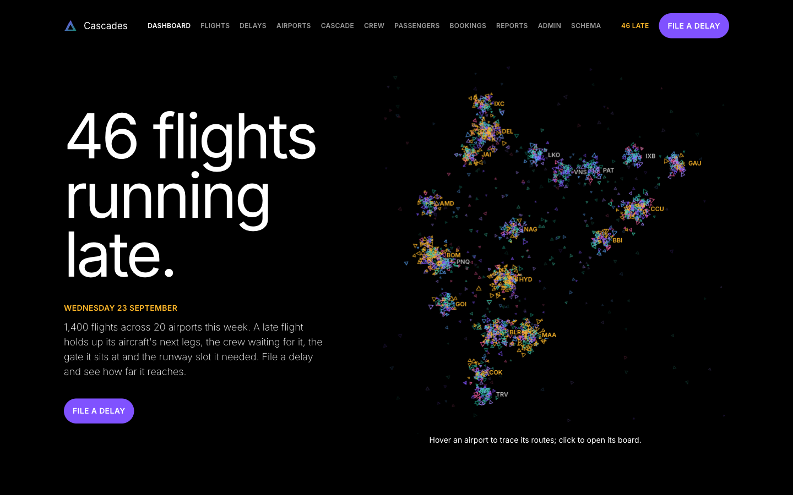
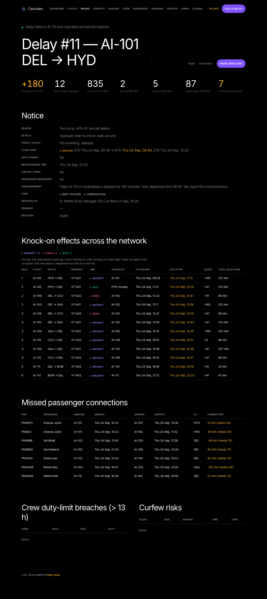

# Airline Cascades

An airline operations database where one late flight moves everything that
depends on it. File a delay on any flight and MySQL works out the knock-on
effects across the whole network: the same aircraft's later legs, the crew
waiting for that aircraft, the next flight at the gate, and runway slots at
congested airports. Every flight it moves is logged with the reason and its
old and new times, and the passengers, crew and airports that end up in
trouble are flagged.

The logic lives in the database (stored procedures, triggers, views and a
recursive CTE); the Flask app is a thin layer that shows it and lets you drive it.



## What it does

- **Delay cascade.** `simulate_delay()` applies a delay notice (IATA AHM 730
  code, minutes or a new ETD, gate change, aircraft swap, passenger care) and
  then re-evaluates four rules until nothing else moves:

  | Link | Rule |
  |---|---|
  | Aircraft | A leg can't leave before the same aircraft lands plus the airport's minimum turnaround |
  | Crew | A crew member's next flight can't leave until 45 min after their previous one lands |
  | Gate | The next flight at a gate can't start boarding until 10 min after the previous one pushes back |
  | Slot | An airport can't exceed its departures per clock hour; the overflow moves to the next hour |

- **Fallout, always current.** Estimated times, missed connections, crew over
  the 13-hour duty limit and flights now outside an airport's curfew are views,
  so they can't drift from the data.
- **Rebooking.** Passengers whose connection broke can be moved, one at a time
  or all at once from a delay's impact page, to the next flight on the same
  route they can still make that has a free seat (in their own cabin where
  possible).
- **Operations clock.** Run the operation forward to any time: flights board,
  depart and land at their estimated times, crew duty hours are booked by
  trigger as each flight lands, notices close and finished journeys complete.
- **Everything editable.** Full CRUD for flights, crew, passengers, bookings,
  airports and their operating rules, gates, routes, aircraft and delay codes.
  Changes made directly in the MySQL client (new rows, columns, ENUM values,
  tables or views) show on the next page load.
- **JSON API** for the same operations, under `/api/v1`.



## Data

The seed builds a self-consistent hub-and-spoke airline around today's date:

| | 7 days (default) | 28 days |
|---|---|---|
| Airports | 20, with gates, curfews and slot limits | 20 |
| Aircraft | 40 (A320, A321neo, 737-800, 777-300ER) | 40 |
| Flights | 1,400 | 5,600 |
| Crew | 400, in 4-person teams | 400 |
| Passengers | 2,000 | 8,000 |
| Tickets | ~15,000, incl. ~1,500 connecting journeys | ~60,000 |

With no delays filed the schedule satisfies every cascade rule and raises no
flags, so flights only ever move because somebody filed a delay. The tests
check this.

## Running it

### With Docker

```
docker compose up --build
```

Open http://localhost:5000. The database is built on first start. For a
longer schedule, `SEED_DAYS=28 REBUILD_DB=1 docker compose up`.

### Locally

Needs Python 3.9+ and MySQL 8.0+ (for `WITH RECURSIVE`, window functions and
enforced `CHECK` constraints), with the `mysql` client on your PATH.

```
cp .env.example .env          # set your MySQL password
pip install -r requirements.txt
bash scripts/setup_db.sh      # SEED_DAYS=28 bash scripts/setup_db.sh for four weeks
python app.py
```

Rebuilding the database is also how you start over: the seed is relative to
the day you build it.

## A quick tour

1. **Flights** → **Delay** on any upcoming flight. Pick a code and type the
   minutes; the form fills in the new ETD, boarding time and a draft announcement.
2. **File delay & cascade** opens the impact page: every flight it moved, which
   link moved it, and the passengers and crew affected.
3. **Rebook all** on that page moves the stranded passengers.
4. **Airports** → **Board** shows scheduled against estimated times.
5. **Cascade** traces the delay tree from any flight (recursive CTE over
   `parent_flight_id`).
6. On the dashboard, **Run to this time** moves the operation forward.
7. **Delays** → **Reset all delays** puts every flight back on schedule.

## API

```
GET  /api/v1/flights?status=&date=YYYY-MM-DD&q=
GET  /api/v1/flights/<id>
POST /api/v1/flights/<id>/delays
GET  /api/v1/delays?open=1
GET  /api/v1/delays/<id>
GET  /api/v1/airports
GET  /api/v1/airports/<IATA>/board?date=YYYY-MM-DD
GET  /api/v1/network
POST /api/v1/clock
```

Filing a delay takes the same fields as the form and returns the notice with
its knock-on impact:

```
curl -X POST localhost:5000/api/v1/flights/412/delays \
  -H 'Content-Type: application/json' \
  -d '{"code": "41", "minutes": 120, "reported_by": "MCC", "meal_voucher": true}'
```

Invalid notices get a `422` listing what's wrong; a flight that has already
landed gets a `409` with MySQL's message.

## Tests

```
pip install -r requirements-dev.txt
pytest
```

Each test module rebuilds the database first, so point `.env` at a database
you don't mind losing. The suite covers the cascade invariants (zero-delay
consistency, every minute accounted for, no rule left violated after it
settles), rebooking, the clock, the API, every page rendering, and hand-made
schema changes. CI runs it against MySQL 8.0 and also builds and starts the
Docker image.

## Layout

```
database/         schema, seed data, triggers, procedures, views (run in order)
  queries/        the eight analytical queries behind the reports
src/services/     all SQL used by the app, one module per area
src/routes/       Flask blueprints (pages and /api/v1)
templates/        Jinja templates
static/           CSS and the dashboard's network canvas
scripts/          database build and container entrypoint
tests/            pytest suite
docs/             design notes
```

## Design notes

- [docs/SCHEMA_DIAGRAM.md](docs/SCHEMA_DIAGRAM.md): ER diagram and the 20 tables by dependency layer
- [docs/NORMALIZATION.md](docs/NORMALIZATION.md): 3NF per table and the two deliberate denormalizations
- [docs/DEVIATIONS.md](docs/DEVIATIONS.md): MySQL restrictions that shaped the design, e.g. why the cascade is a procedure and not a trigger
- [docs/DESIGN_QA.md](docs/DESIGN_QA.md): common questions about how it works
- [docs/CRUD_MATRIX.md](docs/CRUD_MATRIX.md): which page implements each operation

Originally built as a database systems course project.

## License

MIT
