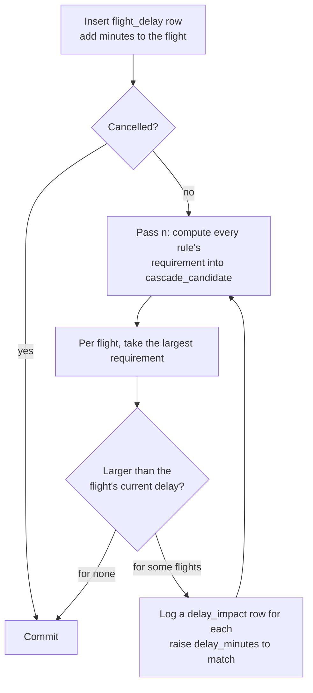

# The cascade engine

How one delay notice turns into every knock-on change across the airline,
entirely inside MySQL. The code is `simulate_delay()` and
`compute_cascade_candidates()` in [`database/05_procedures.sql`](../database/05_procedures.sql).

## The problem

An airline schedule is a web of dependencies. A flight can't leave until:

- its **aircraft** has landed from the previous leg and been turned round,
- its **crew** have arrived on their previous flight and made the connection,
- its **gate** is free of the previous departure, and
- its departure airport has a **runway slot** left in that hour.

Delay one flight and each of those dependencies may push another flight back,
which pushes others back in turn. The engine finds the new state of the whole
schedule: the smallest set of delays that satisfies every dependency again,
and a record of which dependency moved each flight.

## Data model in one paragraph

Scheduled times live on `flight`. The only thing the engine changes is
`flight.delay_minutes`; estimated times are derived on read
(`ETD = sched_departure + delay_minutes`, same for ETA, in the
`v_flight_times` view), so they can never disagree with the delay. A filed
notice is a `flight_delay` row. Every change the engine makes is a
`delay_impact` row: which flight moved, by how much, from which ETD to
which, which link caused it, which flight was the cause, and in which pass.
`flight.parent_flight_id` keeps the most recent causing flight, which is what
the recursive cascade trace walks.

## The four rules

Each rule answers one question for every flight that hasn't left yet: *what
is the smallest delay this flight needs for this rule to hold?* A rule is
satisfied when that number is no more than the flight's current delay.

| Link | Predecessor found by | Requirement on flight Y, given predecessor X |
|---|---|---|
| `AIRCRAFT` | `LAG()` over flights `PARTITION BY aircraft_id ORDER BY std` | `X.ETA + turnaround(Y.origin) − Y.STD` |
| `CREW` | `LAG()` over each crew member's assignments, `ORDER BY std` | `X.ETA + 45 min − Y.STD` |
| `GATE` | `LAG()` over flights `PARTITION BY gate_id ORDER BY std` | `X.ETD + 10 min − Y.boarding_start` |
| `SLOT` | `ROW_NUMBER()` over departures per airport and clock hour of ETD | if Y ranks beyond the airport's hourly limit: start of the next hour − Y.STD |

Two details matter:

- **Predecessors are found by schedule, not by estimate.** Ordering by STD
  means a delay never reorders an aircraft's legs or a crew member's duties;
  the rotation stays what the planners built.
- **The slot rule protects flights that are on time.** Within an hour,
  `ROW_NUMBER()` orders undelayed flights first (`ORDER BY delay_minutes > 0,
  etd`), so a late flight arriving in a full hour is the one bumped, not the
  flight that was there on schedule.

The turnaround and connection times are per airport (`airport.min_turnaround_min`,
`airport.min_connect_min`); the crew connection (45 min) and gate clearance
(10 min) are airline-wide constants.

## The loop



In SQL, one pass is:

```sql
CALL compute_cascade_candidates(v_from, v_to);   -- fills cascade_candidate

INSERT INTO delay_impact (...)
SELECT ... FROM (
  SELECT c.*, ROW_NUMBER() OVER (PARTITION BY c.flight_id
                                 ORDER BY c.required_delay DESC, c.link) AS rn
  FROM cascade_candidate c) w
JOIN flight f ON f.flight_id = w.flight_id
WHERE w.rn = 1 AND w.required_delay > f.delay_minutes;

UPDATE flight f JOIN delay_impact di ON ... AND di.pass_no = v_pass
SET f.delay_minutes = f.delay_minutes + di.minutes_added, ...;

SET v_changed = ROW_COUNT();   -- the loop ends when a pass changes nothing
```

The whole call runs in one transaction with an exit handler that rolls back
and re-raises, so a failure part-way leaves the schedule untouched.

### Why it terminates

`delay_minutes` only ever increases, and only when a rule requires more than
the flight already has. Each rule's requirement is bounded (it depends on
other flights' times, which are bounded by the schedule), so every flight's
delay can rise only finitely often, and the loop reaches a pass where nothing
changes. The 50-pass cap is a backstop, not something the logic relies on.

### Why it's minimal

A flight is only ever raised to exactly what its largest requirement demands,
never past it. So when the loop stops, every flight's delay is the smallest
one consistent with every rule given the delays upstream of it: nothing is
moved further than it has to be.

### Why it's a procedure, not a trigger

The natural design is an `AFTER UPDATE ON flight` trigger that updates the
next flights. MySQL rejects a trigger that modifies the table it fires on
(error 1442), and doesn't let triggers recurse to walk a chain. An explicit
fixed-point loop also makes each pass observable, which the `pass_no` column
records. See [DEVIATIONS.md](DEVIATIONS.md) §4.

## Keeping passes cheap

Each pass re-evaluates the rules with window functions, which costs time in
proportion to the flights it looks at. `compute_cascade_candidates(p_from, p_to)`
takes a time window, and `simulate_delay()` narrows it to the part of the
schedule that can move:

- **`p_from` = delayed flight's STD − 1 day.** Delays only push flights
  later, so nothing earlier can move.
- **`p_to` = latest ETA moved so far + 1 day**, recomputed each pass. Every
  rule's requirement on a flight comes from something that happens before
  that flight's scheduled time plus a small fixed slack, so a flight scheduled
  more than a day after everything that has moved can't be affected yet.

Cutting the window is safe for `LAG()`: a lower cut can only hide a flight's
predecessor (giving no requirement, never a wrong one), and an upper cut
removes successors, which `LAG()` never looks at.

On a 28-day schedule (5,600 flights, 22,400 crew assignments) a 180-minute
delay that settles in three passes took 6.5 s with whole-schedule passes and
0.5 s with the window, with the same result. Tests re-check the entire
schedule afterwards (`compute_cascade_candidates(NULL, NULL)`) and find no
rule left violated.

## Worked example

Seeded schedule, 7 days. A 180-minute technical delay (IATA 41) on AI-101,
Delhi to Hyderabad, VT-A01, scheduled 05:40. The engine settles in six
passes:

| Pass | Flight | Route | Aircraft | Link | Caused by | ETD before | ETD after | Added |
|---|---|---|---|---|---|---|---|---|
| 1 | AI-102 | HYD → DEL | VT-A01 | AIRCRAFT | AI-101 | 08:28 | 11:13 | +165 |
| 2 | AI-102 | HYD → DEL | VT-A01 | SLOT | HYD runway | 11:13 | 12:00 | +47 |
| 2 | AI-103 | DEL → GAU | VT-A01 | AIRCRAFT | AI-102 | 11:11 | 13:56 | +165 |
| 2 | AI-109 | DEL → CCU | VT-A02 | CREW | AI-102 | 13:22 | 13:41 | +19 |
| 3 | AI-103 | DEL → GAU | VT-A01 | AIRCRAFT | AI-102 | 13:56 | 14:43 | +47 |
| 3 | AI-109 | DEL → CCU | VT-A02 | CREW | AI-102 | 13:41 | 14:28 | +47 |
| 3 | AI-104 | GAU → DEL | VT-A01 | AIRCRAFT | AI-103 | 13:19 | 15:59 | +160 |
| 3 | AI-110 | CCU → DEL | VT-A02 | AIRCRAFT | AI-109 | 16:01 | 16:10 | +9 |
| 4 | AI-104 | GAU → DEL | VT-A01 | AIRCRAFT | AI-103 | 15:59 | 16:46 | +47 |
| 4 | AI-110 | CCU → DEL | VT-A02 | AIRCRAFT | AI-109 | 16:10 | 16:57 | +47 |
| 5 | AI-111 | DEL → BOM | VT-A02 | AIRCRAFT | AI-110 | 18:55 | 19:36 | +41 |
| 6 | AI-112 | BOM → DEL | VT-A02 | AIRCRAFT | AI-111 | 21:21 | 22:02 | +41 |

What it shows:

- **Slots compound delays.** AI-102's aircraft is ready at 11:13, but
  Hyderabad's 11:00 hour is full, so it is bumped to 12:00. That extra 47
  minutes then runs down the rest of VT-A01's day.
- **Crew carry delays between aircraft.** AI-109 is on a different aircraft
  (VT-A02), but its crew arrive on AI-102. Through them the delay jumps to a
  second rotation, which carries it to Mumbai and back that evening.
- **Slack absorbs part of it.** AI-109 needs only +19 at first, and AI-110
  only +9, because their schedules had spare time; by AI-111 the knock-on
  has shrunk from 165 to 41 minutes.

In total, 7 other flights move, by 835 minutes between them, across 2
aircraft and 5 airports. 87 passengers are on affected flights, and 7
connections break; those are read from `v_missed_connections` and can be
rebooked from the impact page.

## Things the engine deliberately doesn't do

- **Pull flights earlier.** Delays only grow. Undoing a delay is a reset
  (`reset_all_delays()`), not a negative notice.
- **Re-plan.** It doesn't swap aircraft, reassign crew or cancel flights to
  absorb a delay; those are decisions a duty manager files as notices (the
  notice form has gate change, aircraft swap and cancellation).
- **Store derived state.** Missed connections, duty-limit breaches and
  curfew risks are views over current estimates, so they are always correct
  for the current state and need no maintenance.

## Checking it

[`tests/test_cascade.py`](../tests/test_cascade.py) checks the engine's
invariants on the seeded data:

1. With no delays, the schedule already satisfies every rule and every flag
   view is empty, so flights only move because of a notice.
2. A delay reaches the next leg of the same aircraft and a different aircraft
   through its crew, and breaks a passenger connection.
3. Every flight's delay equals what was filed on it plus its logged knock-on.
4. After the engine stops, no rule anywhere in the schedule is violated.
5. A cancellation moves nothing downstream, a landed flight can't be delayed,
   and a reset returns the network to schedule.
