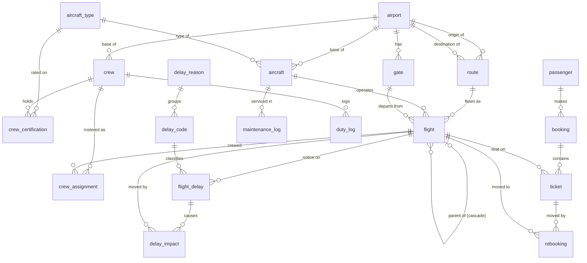

# Schema diagram

20 tables and 4 views, organized into 5 dependency layers (as laid out in
`database/01_schema.sql`) — each layer only references tables in layers
above it. The live schema, with column types and keys, is also browsable at
runtime under **Schema** in the app (backed by `information_schema`).

## Layer 1 — no foreign keys

- **`airport`** — `airport_id` PK
- **`aircraft_type`** — `type_id` PK
- **`delay_reason`** — `reason_id` PK

## Layer 2 — reference Layer 1

- **`gate`** → `airport` (gates and terminals at each airport)
- **`delay_code`** → `delay_reason` (IATA AHM 730 codes, each in one category)
- **`route`** → `airport` (origin), `airport` (destination)
- **`aircraft`** → `aircraft_type`, `airport` (base)
- **`crew`** → `airport` (base)
- **`passenger`** — no FKs (referenced by `booking`)

## Layer 3 — reference Layer 2

- **`flight`** → `route`, `aircraft`, `gate` (departure gate), and **`flight`** itself
  (`parent_flight_id`, self-referencing — this is what makes the cascade a
  recursive structure: a flight's `parent_flight_id` points at the upstream
  flight that caused its delay)
- **`crew_certification`** → `crew`, `aircraft_type`
- **`duty_log`** → `crew`
- **`maintenance_log`** → `aircraft`
- **`booking`** → `passenger`

## Layer 4 — reference Layer 3

- **`crew_assignment`** → `flight`, `crew` (composite PK on the pair —
  models the many-to-many between flights and crew)
- **`flight_delay`** (a delay notice) → `flight`, `delay_code`, `gate` (gate
  change), `aircraft` (swap)
- **`delay_impact`** → `flight_delay`, `flight` (affected), `flight` (cause) —
  one row per knock-on change the cascade engine made
- **`cascade_candidate`** — no FKs; the engine's per-pass scratch table
- **`ticket`** → `booking`, `flight`

## Layer 5 — reference Layer 4

- **`rebooking`** → `ticket`, `flight` (the flight left), `flight` (the flight
  moved to) — one row per ticket moved by `rebook_ticket()`

## Views

- **`v_flight_times`** — every flight with ETD/ETA (scheduled + `delay_minutes`),
  gate and display status (ON TIME / DELAYED / ...)
- **`v_missed_connections`** — bookings whose onward flight now leaves sooner
  than the connecting airport's minimum connection time
- **`v_duty_breaches`** — crew whose first-departure-to-last-arrival exceeds 13 h
- **`v_curfew_risk`** — flights now departing/arriving outside airport opening hours

## The cascade relationship

`flight.parent_flight_id → flight.flight_id` is the one self-referencing
edge in the schema. It's what `analyse_cascade()`'s recursive CTE walks:
starting from a root flight, it follows every flight whose
`parent_flight_id` points back into the set already visited, one level per
`UNION ALL` iteration, producing the full downstream delay tree.

The full organisation-wide cascade doesn't need an FK per link: aircraft,
crew and gate links are found by `LAG()` over flights partitioned by
aircraft, crew member and gate, and slot limits by `ROW_NUMBER()` over
departures per airport-hour (`compute_cascade_candidates()`).
`parent_flight_id` records the flight that caused each knock-on delay, and
`delay_impact` records every change with its link type.

## Delete behavior at a glance

Most FKs are `ON DELETE RESTRICT` (you can't delete an airport, route,
aircraft, or aircraft type that's still referenced) — appropriate for
reference data. The exceptions:

- `crew_certification`, `duty_log`, `crew_assignment`, `flight_delay`,
  `delay_impact`, `rebooking`, `gate` are `ON DELETE CASCADE` from their parent (deleting a crew member or flight
  cleans up its dependent rows).
- `maintenance_log` is `ON DELETE CASCADE` from `aircraft`.
- `ticket` is `ON DELETE RESTRICT` from `flight` (a flight with sold tickets
  can't be deleted outright — cancel it instead) but `ON DELETE CASCADE`
  from `booking` (cancelling/deleting a booking removes its tickets).
- `flight.parent_flight_id` is `ON DELETE SET NULL` (deleting an upstream
  flight doesn't delete the downstream ones — it just detaches them from
  the cascade tree).
